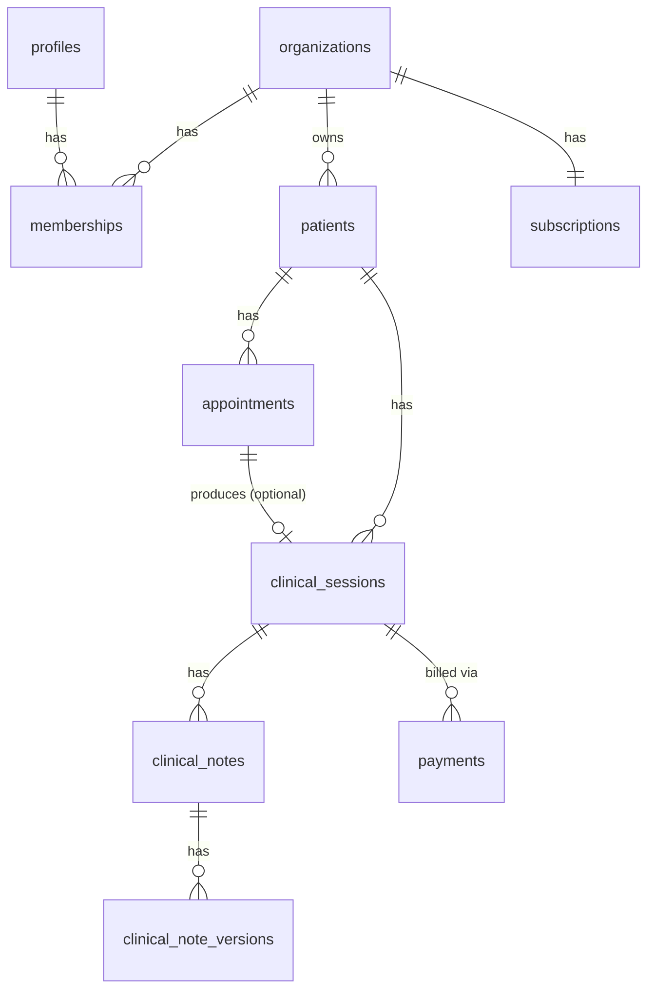

# Database Design

PostgreSQL via Supabase. All tenant-owned tables carry an `organization_id`
column and are protected by Row Level Security (see `docs/SECURITY.md`)
**in addition to** application-level scoping — neither layer alone is
considered sufficient.

## Tenant isolation conventions (apply to every table below)

1. Every tenant-owned table has `organization_id uuid NOT NULL` and a
   compound unique constraint `UNIQUE (id, organization_id)`.
2. Every foreign key that could otherwise cross an organization boundary
   is a **composite foreign key** against both the parent's `id` and
   `organization_id` — see [ADR-0004](decisions/0004-composite-foreign-keys.md).
   Columns referencing "a user acting within an org" (professional,
   author, assignee) use a composite FK against
   `memberships (user_id, organization_id)`, not against `profiles`.
3. `organization_id` is indexed on every tenant table; composite indexes
   are added for the query patterns that need them (see below).

## Tables

### `profiles`
Shadow of Supabase's `auth.users`, 1:1.
`id (uuid, = auth.users.id) PK`, `full_name`, `phone`, `locale (varchar, default 'en')`,
`created_at`.

### `organizations`
`id PK`, `name`, `slug UNIQUE`, `type enum(individual, clinic)`,
`subscription_tier`, `settings jsonb` (org-level defaults: timezone,
currency, default locale — kept in `jsonb` rather than dedicated columns
to stay lean until a concrete need for querying on them appears),
`created_at`, `deleted_at` (soft delete).

### `memberships`
`id PK`, `organization_id FK → organizations`, `user_id FK → profiles`,
`role enum(owner, psychologist, admin_staff)` (see
[ADR-0005](decisions/0005-enum-based-roles-for-mvp.md)),
`status enum(active, invited, suspended)`, `created_at`.
**`UNIQUE (organization_id, user_id)`** — this is also the target of every
composite FK referencing "a user within an org."

### `patients`
`id PK`, `organization_id FK NOT NULL`, `full_name`, `date_of_birth`,
`email`, `phone`, emergency contact fields (optional),
`assigned_professional_id` → composite FK to `memberships (user_id, organization_id)`,
nullable, `status enum(active, inactive, archived)`,
`consent_recorded_at`, `created_by`, `deleted_at`.

> `national_id` was deliberately **not** included — no current MVP feature
> (no formal tax invoicing, no insurance claims) justifies collecting it.
> Add it only when a specific feature needs it. See `docs/DATA-INVENTORY.md`.

### `appointments`
`id PK`, `organization_id FK`,
`patient_id` → composite FK to `patients (id, organization_id)`,
`professional_id` → composite FK to `memberships (user_id, organization_id)`,
`scheduled_start timestamptz`, `scheduled_end timestamptz`,
`status enum(scheduled, confirmed, completed, cancelled, no_show)`,
`modality enum(online, in_person)`, `created_by`.

Constraints:
```sql
ALTER TABLE appointments ADD CONSTRAINT appointment_time_valid
  CHECK (scheduled_end > scheduled_start);

-- A professional cannot have two overlapping, non-cancelled appointments.
-- "cancelled" is the only status that frees the slot — scheduled, confirmed,
-- completed and no_show all represent time the professional was unavailable.
ALTER TABLE appointments ADD CONSTRAINT no_professional_overlap
  EXCLUDE USING gist (
    professional_id WITH =,
    tstzrange(scheduled_start, scheduled_end) WITH &&
  ) WHERE (status <> 'cancelled');

-- Same reasoning applied to the patient side: prevents a patient being
-- double-booked across two professionals in the same org at overlapping times.
ALTER TABLE appointments ADD CONSTRAINT no_patient_overlap
  EXCLUDE USING gist (
    patient_id WITH =,
    tstzrange(scheduled_start, scheduled_end) WITH &&
  ) WHERE (status <> 'cancelled');
```
Rescheduling updates the existing row's time range (re-validated by the
same constraints) rather than cancel-and-recreate, preserving one
appointment identity through its lifecycle.

### `clinical_sessions`
Represents a session that actually took place — a distinct concept from
an appointment (a scheduled event). `id PK`, `organization_id FK`,
`patient_id` → composite FK to `patients`,
`appointment_id` → composite FK to `appointments`, nullable,
`professional_id` → composite FK to `memberships`,
`session_date`, `duration_minutes`, `created_by`.

### `clinical_notes` / `clinical_note_versions`
The most sensitive tables in the schema. `clinical_notes` holds
`id PK`, `organization_id FK`,
`clinical_session_id` → composite FK to `clinical_sessions`,
`author_id` → composite FK to `memberships`,
`current_version_id FK → clinical_note_versions`.

`clinical_note_versions` is **append-only** — edits insert a new row, they
never `UPDATE` existing content. See
[ADR-0006](decisions/0006-append-only-clinical-note-versions.md).
`id PK`, `clinical_note_id FK`, `content text`, `created_by`, `created_at`.

### `payments`
Ledger only — not a payment processor integration. `id PK`,
`organization_id FK`, `patient_id` → composite FK to `patients`,
`clinical_session_id` → composite FK to `clinical_sessions`, nullable,
`amount`, `currency`, `status enum(pending, paid, refunded, failed)`,
`payment_method`, `paid_at`.

### `subscriptions` (stub — SaaS billing, not MVP)
`id PK`, `organization_id FK UNIQUE`, `plan`, `status`,
`stripe_customer_id`, `stripe_subscription_id`. Not populated/used until
the subscription billing feature (post-MVP) ships.

### `audit_logs`
Append-only. `id PK`, `organization_id FK`, `actor_user_id`, `action`,
`resource_type`, `resource_id`, `metadata jsonb`, `created_at`. Every
read/write of `clinical_notes` / `clinical_note_versions` is logged here,
not just writes.

## Indexes

- `organization_id` on every tenant table.
- `(organization_id, scheduled_start)` and
  `(organization_id, professional_id, scheduled_start)` on `appointments`
  for calendar queries.
- `(organization_id, patient_id)` on `appointments` and
  `clinical_sessions`.
- `(organization_id, user_id)` unique on `memberships` (also the
  composite-FK target).

## ER overview



> **`profiles`, `organizations`, and `memberships` are implemented** on
> the real Supabase project (`packages/db/prisma/migrations/`) — exactly
> as designed above, with one deviation: the `profiles.id → auth.users.id`
> foreign key is NOT part of the Prisma schema/migration (Supabase blocks
> granting custom roles any privilege on its `auth` schema); it's applied
> once via a separate privileged-connection script,
> `packages/db/sql/profiles-auth-fk.sql` — see
> [ADR-0011](decisions/0011-profiles-auth-fk-via-privileged-connection.md).
> `patients`, `appointments`, `clinical_sessions`, `clinical_notes`,
> `clinical_note_versions`, `payments`, `subscriptions`, and `audit_logs`
> are still only this design, not yet implemented. Update this file in
> the same change as any schema migration.
