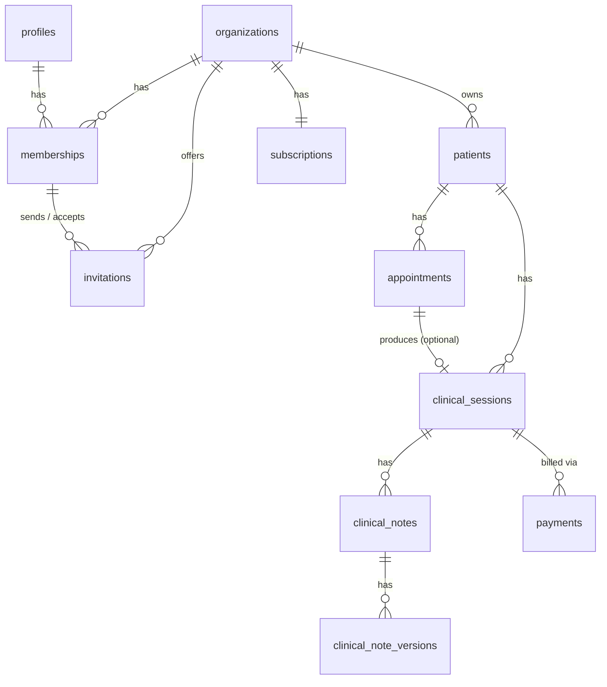

# Database Design

PostgreSQL via Supabase. All tenant-owned tables carry an `organization_id`
column and are protected by Row Level Security (see `docs/SECURITY.md`)
**in addition to** application-level scoping — neither layer alone is
considered sufficient.

## Tenant isolation conventions (apply to every table below)

1. Every tenant-owned table has `organization_id uuid NOT NULL` and a
   compound unique constraint `UNIQUE (id, organization_id)`.
2. Every foreign key that could otherwise cross an organization boundary
   is a **composite foreign key** against both the parent's `id` and
   `organization_id` — see [ADR-0004](decisions/0004-composite-foreign-keys.md).
   Columns referencing "a user acting within an org" (professional,
   author, assignee) use a composite FK against
   `memberships (user_id, organization_id)`, not against `profiles`.
3. `organization_id` is indexed on every tenant table; composite indexes
   are added for the query patterns that need them (see below).

## Tables

### `profiles`
Shadow of Supabase's `auth.users`, 1:1.
`id (uuid, = auth.users.id) PK`, `full_name`, `phone`, `locale (text, default 'en')`,
`created_at`.
`CHECK (locale IN ('en', 'es'))` (`profiles_locale_supported`) — the user
writes this column via `PATCH /me` (F-013), so the database enforces the
supported set as well as the API.

### `organizations`
`id PK`, `name`, `slug UNIQUE`, `type enum(individual, clinic)`,
`subscription_tier`, `settings jsonb` (org-level defaults: timezone,
currency, default locale — kept in `jsonb` rather than dedicated columns
to stay lean until a concrete need for querying on them appears),
`created_by uuid NOT NULL → profiles(id) ON DELETE RESTRICT` (indexed),
`created_at`, `deleted_at` (soft delete).

`created_by` is not only an audit column — it is load-bearing for RLS.
Postgres applies SELECT policies to rows returned by `INSERT ... RETURNING`
(which is what Prisma's `create()` issues), and during bootstrap the
organization is inserted before its first membership can reference it, so a
membership-based policy alone would reject the insert. Attributing the row
to its creator breaks that cycle without weakening isolation. `RESTRICT`
(not `CASCADE`) is deliberate: a user who created an organization cannot be
hard-deleted out from under it, which matches the retention/erasure stance
in `docs/DATA-INVENTORY.md` — account deletion will need an explicit
ownership-transfer or org-deletion flow rather than a silent cascade.

### `memberships`
`id PK`, `organization_id FK → organizations`, `user_id FK → profiles`,
`role enum(owner, psychologist, admin_staff)` (see
[ADR-0005](decisions/0005-enum-based-roles-for-mvp.md)),
`status enum(active, invited, suspended)`, `created_at`.
**`UNIQUE (organization_id, user_id)`** — this is also the target of every
composite FK referencing "a user within an org."
A row can be inserted in exactly two ways (one merged `memberships_insert`
policy): adding yourself to an organization you just created (bootstrap), or
adding yourself, as `active`, with exactly the role of a pending unexpired
invitation addressed to your verified email. `status = 'invited'` is unused —
see `invitations`.

### `invitations`
An owner's offer for someone to join ([ADR-0013](decisions/0013-organization-invitations.md)).
Separate from `memberships` because the invitee usually has no profile (no
user id) yet.
`id PK`, `organization_id FK → organizations ON DELETE CASCADE`,
`email` (lower-cased, CHECK-enforced), `role` (`MembershipRole`,
`CHECK (role <> 'owner')`), `token_hash UNIQUE` (SHA-256 hex of the link
token — the token itself is never stored), `status enum(pending, accepted,
revoked)`, `invited_by` → composite FK to `memberships (organization_id,
user_id)`, `accepted_by` → composite FK to `memberships`, nullable,
`expires_at`, `created_at`, `accepted_at`, `revoked_at`.
`UNIQUE (id, organization_id)`. Partial unique index: one `pending`
invitation per `(organization_id, email)`. A CHECK keeps the lifecycle
columns consistent with `status`.
The two composite FKs are `ON DELETE NO ACTION` rather than `RESTRICT`:
`NO ACTION` is checked at the end of the statement, so cascading an
organization's deletion through both `memberships` and `invitations` works,
while removing just an inviter's membership is still refused.
**Grants:** `app_runtime` may `UPDATE` only `status`, `accepted_by`,
`accepted_at`, `revoked_at`, and may not `DELETE` at all.

### `patients` (implemented, Milestone 2)
`id PK`, `organization_id FK NOT NULL` (cascade with the organization),
`full_name` (required), `date_of_birth date`, `email`, `phone`,
`emergency_contact_name`, `emergency_contact_phone` (all optional),
`status enum(active, inactive, archived)` default `active`, `archived_at`,
`created_by` → composite FK to `memberships (organization_id, user_id)`
(`NO ACTION`, like invitations), `created_at`, `updated_at`.
`UNIQUE (id, organization_id)` — the target of every future composite FK
(appointments, sessions, payments).

- **Archived, never deleted** ([ADR-0014](decisions/0014-patients-archived-not-deleted.md)):
  `app_runtime` has no `DELETE` grant; `UPDATE` only on the detail columns,
  `status`, `archived_at`, `updated_at`. Archiving/restoring is owner-only,
  enforced by the `patients_update` policy via `app_private.has_active_role`.
- **CHECKs:** trimmed non-empty `full_name` ≤ 200; `email` lower-cased ≤ 320;
  phones trimmed ≤ 30; `date_of_birth >= 1900-01-01` ("not in the future" is
  API-only: a CHECK cannot depend on the clock); `status = 'archived'` ⇔
  `archived_at IS NOT NULL`.
- **Indexes:** `(organization_id, full_name)` for the name-ordered list,
  `(organization_id, created_by)` for the creator FK. Search is a
  case-insensitive substring match (`ILIKE`) inside one organization — fine at
  a practice's scale (hundreds of rows); revisit with `pg_trgm` if a clinic
  ever has tens of thousands. Accent-insensitive search ("Jose" finding
  "José") is not implemented yet.
- **Planned columns dropped from the original sketch:** `assigned_professional_id`,
  `consent_recorded_at`, `deleted_at` (replaced by `status`/`archived_at`) —
  see ADR-0014 for why.

> `national_id` was deliberately **not** included — no current MVP feature
> (no formal tax invoicing, no insurance claims) justifies collecting it.
> Add it only when a specific feature needs it. See `docs/DATA-INVENTORY.md`.

### `appointments` (implemented, Milestone 3)
`id PK`, `organization_id FK` (cascade with the organization),
`patient_id` → composite FK to `patients (id, organization_id)`,
`professional_id` → composite FK to `memberships (organization_id, user_id)`,
`scheduled_start timestamptz`, `scheduled_end timestamptz`,
`status enum(scheduled, confirmed, completed, cancelled, no_show)` default
`scheduled`, `modality enum(in_person, online)` default `in_person`,
`created_by` → composite FK to `memberships`, `created_at`, `updated_at`,
`cancelled_at`. `UNIQUE (id, organization_id)` for future composite FKs
(clinical sessions, payments). No free-text notes column (clinical content
would reach `admin_staff`).

Constraints ([ADR-0015](decisions/0015-appointment-conflicts-per-organization.md)):
```sql
ALTER TABLE appointments ADD CONSTRAINT appointment_time_valid CHECK (
  scheduled_end > scheduled_start
  AND scheduled_end - scheduled_start <= interval '12 hours'
);

-- Half-open ranges: back-to-back appointments are allowed. "cancelled" is the
-- only status that frees the slot. Scoped per organization: constraint checks
-- see all rows (no RLS), so a cross-organization check would leak another
-- practice's schedule through the conflict error.
ALTER TABLE appointments ADD CONSTRAINT no_professional_overlap
  EXCLUDE USING gist (
    organization_id WITH =,
    professional_id WITH =,
    tstzrange(scheduled_start, scheduled_end, '[)') WITH &&
  ) WHERE (status <> 'cancelled');

ALTER TABLE appointments ADD CONSTRAINT no_patient_overlap
  EXCLUDE USING gist (
    organization_id WITH =,
    patient_id WITH =,
    tstzrange(scheduled_start, scheduled_end, '[)') WITH &&
  ) WHERE (status <> 'cancelled');
```
Plus `appointments_cancelled_consistent` (`status = 'cancelled'` ⇔
`cancelled_at IS NOT NULL`). Requires `btree_gist`
(`packages/db/sql/extensions.sql`, `extensions` schema).

Rescheduling updates the existing row's time range (re-validated by the
same constraints) rather than cancel-and-recreate, preserving one
appointment identity through its lifecycle.

- **Grants:** no `DELETE`; `UPDATE` only on `professional_id`,
  `scheduled_start`, `scheduled_end`, `status`, `modality`, `cancelled_at`,
  `updated_at` — the patient, organization and creator never change.
- **RLS:** tenant + verified membership on every policy. Insert: as yourself,
  never pre-cancelled, professional must be an active owner/psychologist
  (`app_private.is_active_clinician`), patient not archived. Update: a
  cancelled row is invisible (final); the new row's professional must be a
  valid clinician unless the update is the cancellation itself.

### `clinical_sessions`
Represents a session that actually took place — a distinct concept from
an appointment (a scheduled event). `id PK`, `organization_id FK`,
`patient_id` → composite FK to `patients`,
`appointment_id` → composite FK to `appointments`, nullable,
`professional_id` → composite FK to `memberships`,
`session_date`, `duration_minutes`, `created_by`.

### `clinical_notes` / `clinical_note_versions`
The most sensitive tables in the schema. `clinical_notes` holds
`id PK`, `organization_id FK`,
`clinical_session_id` → composite FK to `clinical_sessions`,
`author_id` → composite FK to `memberships`,
`current_version_id FK → clinical_note_versions`.

`clinical_note_versions` is **append-only** — edits insert a new row, they
never `UPDATE` existing content. See
[ADR-0006](decisions/0006-append-only-clinical-note-versions.md).
`id PK`, `clinical_note_id FK`, `content text`, `created_by`, `created_at`.

### `payments`
Ledger only — not a payment processor integration. `id PK`,
`organization_id FK`, `patient_id` → composite FK to `patients`,
`clinical_session_id` → composite FK to `clinical_sessions`, nullable,
`amount`, `currency`, `status enum(pending, paid, refunded, failed)`,
`payment_method`, `paid_at`.

### `subscriptions` (stub — SaaS billing, not MVP)
`id PK`, `organization_id FK UNIQUE`, `plan`, `status`,
`stripe_customer_id`, `stripe_subscription_id`. Not populated/used until
the subscription billing feature (post-MVP) ships.

### `audit_logs`
Append-only. `id PK`, `organization_id FK`, `actor_user_id`, `action`,
`resource_type`, `resource_id`, `metadata jsonb`, `created_at`. Every
read/write of `clinical_notes` / `clinical_note_versions` is logged here,
not just writes.

## Indexes

- `organization_id` on every tenant table.
- `(organization_id, scheduled_start)` and
  `(organization_id, professional_id, scheduled_start)` on `appointments`
  for calendar queries (implemented); the two exclusion constraints add
  their own GiST indexes.
- `(organization_id, patient_id)` on `appointments` and
  `clinical_sessions`.
- `(organization_id, user_id)` unique on `memberships` (also the
  composite-FK target); `memberships (user_id)` for "my memberships"
  lookups; `organizations (created_by)`.
- CI fails if `schema.prisma` and the migrations disagree (`check:drift`).
  Prisma does not model CHECK constraints, partial indexes or policies, so
  those are covered by the integration suite instead.
- `invitations`: `(organization_id, invited_by)` and
  `(organization_id, accepted_by)` (cover the composite FKs and serve as the
  per-tenant index), `token_hash` unique, partial unique
  `(organization_id, email) WHERE status = 'pending'`.

## ER overview



> **`invitations` (and the `profiles.locale` CHECK) exist in migrations
> `20261114120000_invitations` / `20261114130000_profiles_locale_check`**
> and are applied to the Supabase project (2026-11-14). Rollout order for
> any future change touching both: `sql/rls-helpers.sql` first, then
> `migrate:deploy`.
>
> **`profiles`, `organizations`, and `memberships` are implemented** on
> the real Supabase project (`packages/db/prisma/migrations/`) — exactly
> as designed above, with one deviation: the `profiles.id → auth.users.id`
> foreign key is NOT part of the Prisma schema/migration (Supabase blocks
> granting custom roles any privilege on its `auth` schema); it's applied
> once via a separate privileged-connection script,
> `packages/db/sql/profiles-auth-fk.sql` — see
> [ADR-0011](decisions/0011-profiles-auth-fk-via-privileged-connection.md).
> `patients`, `appointments`, `clinical_sessions`, `clinical_notes`,
> `clinical_note_versions`, `payments`, `subscriptions`, and `audit_logs`
> are still only this design, not yet implemented. Update this file in
> the same change as any schema migration.
